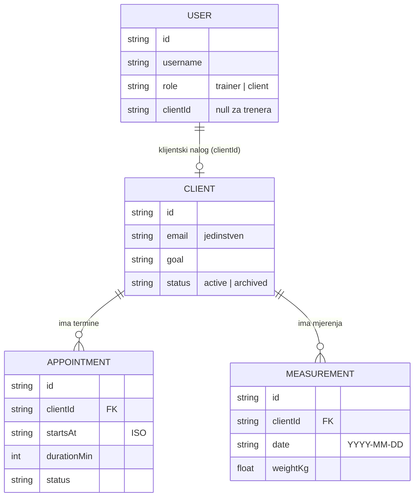

# FitBuddy – entiteti i API ugovor (za backend)

Ovaj dokument opisuje podatke i rute koje frontend očekuje. Mock API (MSW, `frontend/src/features/*/api/*.mock.ts`) se ponaša tačno ovako –
backend treba da implementira iste rute, pa frontend radi bez izmjena (`VITE_USE_MOCKS=false`, `VITE_API_URL=https://…/api`).

TypeScript tipovi su izvor istine: `frontend/src/features/<feature>/types.ts`.

## Dogovori

- Osnovna adresa: `/api`. Tijela zahtjeva i odgovora su JSON (`Content-Type: application/json`).
- **ID** je string (mock koristi `c-…`, `a-…`, `m-…`; backend može UUID).
- **Kalendarski datum**: `"YYYY-MM-DD"` (npr. `startDate`, `date`). **Trenutak**: ISO 8601 u UTC (`"2026-10-19T16:00:00.000Z"`, npr. `startsAt`, `createdAt`).
- Svaki entitet ima `createdAt` i `updatedAt` (ISO), koje postavlja server.
- Prazan opcioni tekst je `""`, a prazan opcioni broj ili datum je `null`.
- **Autentifikacija**: svaki zahtjev osim prijave šalje `Authorization: Bearer <token>`.

### Greške

| Status | Kada                                                            | Tijelo                                                                                          |
| ------ | --------------------------------------------------------------- | ----------------------------------------------------------------------------------------------- |
| 401    | nema tokena / token nevažeći                                    | `{ "message": "Sesija je istekla. Prijavi se ponovo." }` – frontend odjavljuje korisnika        |
| 403    | uloga nema pravo ili tuđi podatak                               | `{ "message": "Nemaš pristup ovom podatku." }`                                                  |
| 404    | ne postoji                                                      | `{ "message": "…" }`                                                                            |
| 409    | konflikt (preklapanje termina, zauzet email, kasno otkazivanje) | `{ "message": "…", "fieldErrors"?: { "polje": "poruka" } }`                                     |
| 422    | validacija                                                      | `{ "message": "Provjeri označena polja.", "fieldErrors": { "email": "Email nije ispravan…" } }` |
| 429    | previše pokušaja prijave                                        | `{ "message": "Previše neuspjelih pokušaja. Pokušaj ponovo za 15 min." }`                       |

`fieldErrors` ključevi su imena polja iz tijela zahtjeva; frontend ih prikazuje ispod odgovarajućih polja forme. Poruke su na crnogorskom.

## Dijagram veza

## Uloge i prava

| Resurs   | Trener                                               | Klijent                                                                                                                                   |
| -------- | ---------------------------------------------------- | ----------------------------------------------------------------------------------------------------------------------------------------- |
| Klijenti | sve (lista, detalj, kreiranje, izmjena, arhiviranje) | samo `GET /api/clients/:id` za sebe                                                                                                       |
| Termini  | sve                                                  | lista i detalj **samo svojih**; kreira **zahtjev** za sebe (status `pending`); može samo da **otkaže** svoj termin, najkasnije 24 h prije |
| Mjerenja | sve                                                  | lista, detalj, kreiranje, izmjena, brisanje **samo svojih** (`clientId` server postavlja sam)                                             |

---

## Auth

### `SessionUser`

| Polje         | Tip                     | Opis                                                       |
| ------------- | ----------------------- | ---------------------------------------------------------- |
| `id`          | string                  | ID korisničkog naloga                                      |
| `username`    | string                  | korisničko ime (mala slova)                                |
| `role`        | `"trainer" \| "client"` | uloga                                                      |
| `displayName` | string                  | ime za prikaz                                              |
| `clientId`    | string \| null          | za ulogu klijenta: ID zapisa u `Client`; za trenera `null` |

### Rute

| Metoda i putanja        | Tijelo                   | Odgovor                                                                                                                                                                  |
| ----------------------- | ------------------------ | ------------------------------------------------------------------------------------------------------------------------------------------------------------------------ |
| `POST /api/auth/login`  | `{ username, password }` | `200 { token, user: SessionUser }` · `401` pogrešni podaci (poruka ne otkriva da li korisnik postoji, navodi preostale pokušaje) · `422` prazna polja · `429` zaključano |
| `GET /api/auth/me`      | –                        | `200 SessionUser` · `401`                                                                                                                                                |
| `POST /api/auth/logout` | –                        | `204`                                                                                                                                                                    |

Pravila: posle **5 neuspjelih pokušaja** korisničko ime se zaključava na **15 minuta**. Lozinke se čuvaju samo heširane (Argon2/bcrypt).
Mock nalozi: `trener` (uloga trener) i `klijent` (uloga klijent, povezan sa klijentom `c-ana`). Registracija nije dio ovog izdanja.

---

## Client (klijent)

`frontend/src/features/clients/types.ts`

| Polje                    | Tip                                                                       | Obavezno | Pravila                                                                    |
| ------------------------ | ------------------------------------------------------------------------- | -------- | -------------------------------------------------------------------------- |
| `id`                     | string                                                                    | –        | server                                                                     |
| `firstName`              | string                                                                    | da       | ne prazno                                                                  |
| `lastName`               | string                                                                    | da       | ne prazno                                                                  |
| `email`                  | string                                                                    | da       | ispravan format, **jedinstven** (409 ako je zauzet), čuva se malim slovima |
| `phone`                  | string \| null                                                            | ne       |                                                                            |
| `birthDate`              | `YYYY-MM-DD` \| null                                                      | ne       | ne u budućnosti                                                            |
| `heightCm`               | number \| null                                                            | ne       | 100–250                                                                    |
| `goal`                   | `"fat_loss" \| "muscle_gain" \| "strength" \| "conditioning" \| "health"` | da       |                                                                            |
| `status`                 | `"active" \| "archived"`                                                  | da       | arhiviran klijent ne može dobiti nove termine                              |
| `startDate`              | `YYYY-MM-DD`                                                              | da       | početak saradnje                                                           |
| `injuries`               | string                                                                    | ne       | povrede i ograničenja                                                      |
| `allergies`              | string                                                                    | ne       | alergije, namirnice koje ne jede                                           |
| `notes`                  | string                                                                    | ne       |                                                                            |
| `createdAt`, `updatedAt` | ISO                                                                       | –        | server                                                                     |

`ClientRef` (kratka referenca u drugim resursima): `{ id, firstName, lastName }`.

`ClientListItem` = `Client` + sažetak koji računa server:

| Polje               | Tip                  | Opis                                                        |
| ------------------- | -------------------- | ----------------------------------------------------------- |
| `nextAppointmentAt` | ISO \| null          | najraniji budući termin u statusu `pending` ili `confirmed` |
| `lastMeasuredAt`    | `YYYY-MM-DD` \| null | datum posljednjeg mjerenja                                  |
| `latestWeightKg`    | number \| null       | težina iz posljednjeg mjerenja koje je ima                  |

### Rute

| Metoda i putanja         | Uloga                     | Parametri / tijelo                                                                                   | Odgovor                                   |
| ------------------------ | ------------------------- | ---------------------------------------------------------------------------------------------------- | ----------------------------------------- |
| `GET /api/clients`       | trener                    | `?search=` (ime, prezime, email) `&goal=` `&status=active\|archived\|all` (podrazumijevano `active`) | `200 ClientListItem[]` sortirano po imenu |
| `GET /api/clients/:id`   | trener; klijent samo sebe | –                                                                                                    | `200 Client` · `403` · `404`              |
| `POST /api/clients`      | trener                    | `ClientInput` (sva polja osim `id`, `createdAt`, `updatedAt`)                                        | `201 Client` · `409` email zauzet · `422` |
| `PUT /api/clients/:id`   | trener                    | `ClientInput`                                                                                        | `200 Client` · `404` · `409` · `422`      |
| `PATCH /api/clients/:id` | trener                    | `{ status }`                                                                                         | `200 Client` (arhiviranje / vraćanje)     |

---

## Appointment (termin)

`frontend/src/features/appointments/types.ts` · veza: `clientId → Client.id` (N:1)

| Polje                    | Tip                                                                   | Obavezno | Pravila                                         |
| ------------------------ | --------------------------------------------------------------------- | -------- | ----------------------------------------------- |
| `id`                     | string                                                                | –        | server                                          |
| `clientId`               | string                                                                | da       | postojeći, **aktivan** klijent (za novi termin) |
| `startsAt`               | ISO                                                                   | da       | klijent: samo u budućnosti                      |
| `durationMin`            | integer                                                               | da       | 15–240 (UI nudi 30, 45, 60, 90)                 |
| `type`                   | `"training" \| "assessment" \| "consultation"`                        | da       |                                                 |
| `status`                 | `"pending" \| "confirmed" \| "completed" \| "cancelled" \| "no_show"` | da       | klijent uvijek kreira `pending`                 |
| `programDay`             | string                                                                | ne       | npr. „Dan B – Noge i leđa”                      |
| `note`                   | string                                                                | ne       |                                                 |
| `createdAt`, `updatedAt` | ISO                                                                   | –        | server                                          |

Odgovori sadrže i `client: ClientRef | null` (`AppointmentWithClient`).

**Pravila:**

- **Bez preklapanja:** termini u statusu `pending` ili `confirmed` ne smiju se preklapati (`[startsAt, startsAt + durationMin)`), bez obzira na klijenta – trener je jedan. Konflikt → `409` sa `fieldErrors.startsAt`. Treneru poruka navodi zauzeti termin, klijentu ne (privatnost).
- **Otkazivanje klijenta:** samo iz `pending`/`confirmed` u `cancelled`, najkasnije **24 h** prije početka (inače `409`).
- Tok statusa: `pending → confirmed | cancelled`, `confirmed → completed | no_show | cancelled`.

### Rute

| Metoda i putanja               | Uloga                                                  | Parametri / tijelo                                                                              | Odgovor                                               |
| ------------------------------ | ------------------------------------------------------ | ----------------------------------------------------------------------------------------------- | ----------------------------------------------------- |
| `GET /api/appointments`        | oba (klijent dobija samo svoje)                        | `?from=ISO&to=ISO&status=&clientId=&order=asc\|desc&limit=` – `from` uključivo, `to` isključivo | `200 AppointmentWithClient[]` sortirano po `startsAt` |
| `GET /api/appointments/:id`    | oba (klijent samo svoj)                                | –                                                                                               | `200 AppointmentWithClient` · `403` · `404`           |
| `POST /api/appointments`       | oba                                                    | `AppointmentInput`; klijentu server postavlja `clientId` i `status: "pending"`                  | `201` · `409` preklapanje · `422`                     |
| `PUT /api/appointments/:id`    | trener                                                 | `AppointmentInput`                                                                              | `200` · `404` · `409` · `422`                         |
| `PATCH /api/appointments/:id`  | trener; klijent samo `{ status: "cancelled" }` za svoj | `{ status }`                                                                                    | `200` · `403` · `409`                                 |
| `DELETE /api/appointments/:id` | trener                                                 | –                                                                                               | `204` · `404`                                         |

Frontend filteri perioda (`today`, `week`, `upcoming` = narednih 30 dana, `past` = posljednjih 90 dana opadajuće, `all`) pretvaraju se u `from`/`to` u `features/appointments/model/filters.ts`.

---

## Measurement (mjerenje)

`frontend/src/features/measurements/types.ts` · veza: `clientId → Client.id` (N:1)

| Polje                    | Tip             | Opseg           | Napomena                               |
| ------------------------ | --------------- | --------------- | -------------------------------------- |
| `id`                     | string          | –               | server                                 |
| `clientId`               | string          | –               | obavezno; klijentu ga postavlja server |
| `date`                   | `YYYY-MM-DD`    | ne u budućnosti | obavezno                               |
| `weightKg`               | number \| null  | 30–300          |                                        |
| `bodyFatPct`             | number \| null  | 3–70            |                                        |
| `waistCm`                | number \| null  | 40–200          | struk                                  |
| `hipsCm`                 | number \| null  | 50–200          | kukovi                                 |
| `chestCm`                | number \| null  | 50–200          | grudi                                  |
| `armCm`                  | number \| null  | 15–70           | nadlaktica                             |
| `thighCm`                | number \| null  | 30–100          | butina                                 |
| `steps`                  | integer \| null | 0–100 000       | dnevni koraci                          |
| `note`                   | string          | –               |                                        |
| `createdAt`, `updatedAt` | ISO             | –               | server                                 |

Pravilo: mjerenje mora imati **bar jednu** brojčanu vrijednost (inače `422` sa `fieldErrors.weightKg`). Odgovori sadrže `client: ClientRef | null`.

### Rute

| Metoda i putanja               | Uloga                    | Parametri / tijelo                                | Odgovor                                       |
| ------------------------------ | ------------------------ | ------------------------------------------------- | --------------------------------------------- |
| `GET /api/measurements`        | oba (klijent samo svoja) | `?clientId=&from=YYYY-MM-DD&to=YYYY-MM-DD&limit=` | `200 MeasurementWithClient[]`, najnovije prvo |
| `GET /api/measurements/:id`    | oba (klijent samo svoje) | –                                                 | `200` · `403` · `404`                         |
| `POST /api/measurements`       | oba                      | `MeasurementInput`                                | `201` · `422`                                 |
| `PUT /api/measurements/:id`    | oba (klijent samo svoje) | `MeasurementInput`                                | `200` · `403` · `404` · `422`                 |
| `DELETE /api/measurements/:id` | oba (klijent samo svoje) | –                                                 | `204` · `403` · `404`                         |

---

## Planirano (još nije u frontendu)

Iz `SPEC.md` – za kasnija izdanja; imena su prijedlog:

| Entitet                                       | Ključna polja                          | Veze                              |
| --------------------------------------------- | -------------------------------------- | --------------------------------- |
| `Exercise` (vježba)                           | name, muscleGroup, equipment, videoUrl | trener                            |
| `Program`, `ProgramDay`, `PrescribedExercise` | sets, reps, targetWeightKg, restSec    | trener → klijent                  |
| `WorkoutSession`, `WorkoutSet`                | date, weightKg, reps, rpe              | klijent, vježba, (opciono) termin |
| `MealPlan`, `Meal`, `MealItem`, `Food`        | kcal, protein, carbs, fat, količina    | trener → klijent                  |
| `Invitation` (pozivnica)                      | token, email, status, expiresAt        | trener → budući klijent           |
| `Trainer` + statusi naloga, admin             | vidi SPEC.md, sekcija 12               |                                   |
